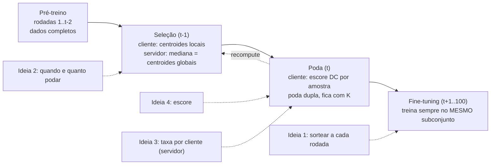

# Melhorar a acurácia do FedCS sem gastar mais energia

Objetivo: o FedCS ganhar acurácia **com a mesma energia**. Onde há espaço: podando cedo (t=5, 61% da energia) faltam 5,4 pp até o teto; no ponto recomendado ({20,60}+adp) faltam só 0,8 pp, quase ruído. **Meta: a poda cedo (barata) chegar perto da poda tardia.**

Referência (CIFAR-10, α=0,1, 3 seeds, Tabela I do artigo):

| Config | Acurácia | Energia |
| --- | --- | --- |
| FedAvg (teto) | 84,86 | 100% |
| Random t=5 / t=20 | 81,55 / 83,19 | 61% / 67% |
| DC t=5 / t=20 | 74,58 / 83,65 | 61% / 67% |
| DC recompute {5,45} / {20,60} | 79,50 / 84,21 | 61% / 67% |

## Fluxo atual e onde cada ideia entra

Por que a energia não muda: a energia é proporcional ao número de amostras treinadas (amostras × épocas × custo do dispositivo). As ideias mudam **quais** amostras ou **quando**, não **quantas**.

---

## Ideia 1 — Sortear um subconjunto novo a cada rodada

**Hoje:** na poda, o cliente fica com as K amostras de melhor escore e treina nelas até o fim.
**Proposta:** o escore vira uma **probabilidade**. A cada rodada do fine-tuning, o cliente sorteia K amostras (mesmo K) e treina nelas.

Como funciona:
- Amostras que o FedCS manteria têm chance alta; as demais têm chance pequena, mas não zero.
- Um botão (temperatura) vai de "sempre as mesmas K" (= FedCS atual) até "sorteio uniforme" (= random).
- O sorteio respeita as mesmas cotas da poda dupla (classes grandes vs. restantes), para não perder o rebalanceamento do FedCS.

Por quê: o recompute (trocar o subconjunto **uma** vez) rendeu +4,93 pp em t=5, e o artigo atribui isso a "acesso" (ver mais dados). Trocar sempre leva isso ao máximo.

Onde no código: `client/fedcs.py` (`_prune_dataset` guarda o escore em vez de só os índices; `fit` da fase de fine-tuning sorteia antes de treinar). Servidor não muda (variantes 1a e 1c).

| Variante | O que faz | Custo de energia extra |
| --- | --- | --- |
| **1a** | escore calculado 1× em t, sorteio a cada rodada | zero |
| **1b** | escore recalculado a cada R rodadas (features mais maduras) | 1 inferência por recálculo (**precisa ser contada**, ver Energia) |
| **1c (controle)** | sorteio uniforme a cada rodada, sem escore | zero |

Trade-offs:
- Se **1c empatar com 1a**, o ganho vem de "ver mais dados", não do critério do FedCS. Isso também é resultado (e responde o revisor sobre o controle aleatório que falta).
- 1b com R pequeno pode virar "treino escondido": cada recálculo é uma passada no dataset inteiro. Só é justo se a energia da inferência for contada.
- Código médio (mexe no laço do cliente).

## Ideia 2 — Mesma energia, distribuída de outro jeito no tempo

**Hoje:** poda 1× em t com pf=0,5 fixo. Energia ≈ (rodadas com dados completos) + (rodadas restantes × fração mantida).
**Proposta:** gastar o **mesmo total** de outro jeito:
- "Podar mais tarde, mais forte": t=20 com pf maior, até a energia bater 61% (a mesma do t=5).
- "Poda progressiva": podar pouco em t=5 e mais em t=45 (o subconjunto encolhe em degraus).

Por quê: o modelo aprende mais no começo (período crítico). Gastar dados ali pode valer mais do que no fim. É exatamente o "podar mais tarde vs. podar menos" que o artigo admite não ter testado (Seção VI).

Onde: só parâmetros (`pretrain-rounds`, `pf`, `prune-rounds`). A poda progressiva precisa de um pf diferente por evento (mudança pequena no servidor dinâmico).

Trade-offs:
- Quase zero código; é o experimento mais barato.
- pf alto na poda tardia pode cortar demais classes pequenas (o piso por classe protege só 1 amostra).
- Casar a energia exatamente exige calibrar o pf (conta offline com os tamanhos das partições e os perfis). Alternativa sem calibrar: plotar na fronteira de Pareto e ver se domina.

## Ideia 3 — Taxa adaptativa mais forte

**Hoje:** o multiplicador da taxa vai de 0,7 (cliente mais barato) a 1,3 (mais caro), ranqueando por **tempo**.
**Proposta:** faixa mais larga (ex.: 0–2) e ranquear por **energia** (`adaptive-rate-cost="energy"`). Os clientes baratos ficam com quase tudo; os caros podam mais.

Por quê: treinar uma amostra custa até 27× mais num dispositivo caro. Mover a poda para onde a amostra é cara permite que o modelo veja **mais amostras pelo mesmo total de energia**.

Onde: servidor, `fedcs_strategy.py` (taxas por cliente). Já existe; só muda parâmetro.

Trade-offs:
- Hoje a taxa adaptativa **economiza** energia além do FedCS. Para uma alegação de acurácia, compare na **mesma energia**: baixe o pf base até o total bater com o FedCS, ou compare na fronteira de Pareto.
- O FedAvg pondera cada cliente pelo nº de amostras treinadas: clientes caros podados perdem peso na agregação. No não-IID, as classes deles ficam sub-representadas e isso pode **piorar** a acurácia. É o principal risco.
- Ranquear por tempo vs. energia quase não muda a ordem no nosso pool (troca só os dois mais baratos), mas para uma alegação de energia use energia.

## Ideia 4 — Usar o sinal da margem

**Hoje:** escore = |distância ao centroide errado mais próximo − distância ao próprio centroide|. Escore alto = "longe da fronteira" = descartado.
**Problema:** o módulo junta dois casos opostos:
- margem **positiva** grande: amostra fácil, bem dentro da própria classe (faz sentido descartar);
- margem **negativa** grande: amostra **errada com confiança**, dentro da região de outra classe (o modelo ainda precisa dela).

O tamanho disso: em t=5, α=0,1, a sonda mede nn_acc=0,358, ou seja, **64% das amostras têm margem negativa**. O módulo trata boa parte delas como "redundantes".

**Proposta:**

| Variante | Regra | Testa a hipótese |
| --- | --- | --- |
| **4a** | margem com sinal: descarta só as de margem positiva alta | amostras erradas ainda são úteis (não aprendidas) |
| **4b** | 4a + descarta primeiro as de margem negativa extrema | amostras erradas são ruído/rótulo ruim |

Onde: `client/fedcs.py`, `_prune_dataset` (uma linha no cálculo do escore + uma flag).

Trade-offs:
- Muito barato; fecha a segunda lacuna admitida no artigo (Seção VI).
- Previsão: ganho grande em t=5 (features imaturas, muitas negativas) e quase nada em t=40 (poucas negativas). Se isso acontecer, separa o efeito "features imaturas" do efeito "escore sem sinal".
- CIFAR tem rótulos limpos, então 4b deve perder para 4a; em dados ruidosos poderia ser o contrário.

---

## Experimentos (triagem)

Regras: CIFAR-10, α=0,1, t ∈ {5, 20}, 2 seeds na triagem (3ª seed só para quem passar). Os baselines já existem (tabela do topo). **Conta como ganho só o que passar de +0,5 pp** (com 3 seeds, menos que isso é empate).

| Ordem | Ideia | Configurações novas | Runs (2 seeds) | Código |
| --- | --- | --- | --- | --- |
| 1 | 4 — sinal da margem | 4a, 4b × t∈{5,20} | 8 | 1 linha + flag |
| 2 | 2 — energia no tempo | t=20 pf calibrado; progressiva {5,45} | 4 | parâmetros (+ pf por evento) |
| 3 | 3 — taxa adaptativa forte | faixa 0–2 (energia) × t∈{5,20} | 4 | parâmetros |
| 4 | 1 — sorteio por rodada | 1a, 1c × t∈{5,20} (1b depois) | 8 | médio |

Total da triagem: ~24 runs, ~5 h cada na `thedeep` → ~5 dias numa GPU. Hoje a `thedeep` está ocupada com o CIFAR-100; a triagem precisa da `thedeep2` ou entra na fila.

Ideias que passarem: rodar 3 seeds, α=1,0 e CIFAR-100. As que combinam (1+4, 2+3) só depois de cada uma provar valor sozinha, para saber de onde vem o ganho.

---

## Energia: estamos medindo certo?

**Hoje (código):** energia = Σ rodadas Σ clientes (amostras treinadas × épocas × energia por amostra do dispositivo). Só treino. Calculada no servidor a partir do `num_examples` que cada cliente devolve.

**Dois problemas encontrados no código:**

| Problema | O que acontece | Efeito |
| --- | --- | --- |
| Rodada de seleção contada como treino | o cliente só faz 1 inferência (centroides) e **não treina**, mas devolve n_i e o servidor conta 5 épocas de treino | **superestima** a energia do FedCS em ~1 rodada por evento de poda (~0,9 pp de energia por evento; recompute tem 2) |
| Inferência da poda não contada | o escore exige outra passada no dataset inteiro | subestima, mas é pequeno (~0,07 pp por evento: 1 inferência custa ~1/3 de 1 época) |

- Saldo hoje: a conta é **contra** o FedCS. As conclusões do artigo não estão infladas, mas os números estão errados (61,2% seria ~59,5%), e o texto do artigo diz "inferência não contada", o que **não bate** com o código. Corrigir antes da atualização do paper.
- Efeito colateral: a rodada de seleção é uma rodada **sem treino**. O FedCS treina 1–2 rodadas a menos que o FedAvg. Calcular os centroides na mesma rodada do treino recupera essa rodada sem custo (ganho de acurácia "de graça").

**O que contar (recomendação):**

| Custo | Contar? | Por quê | Esforço |
| --- | --- | --- | --- |
| Treino | sim (já conta) | custo dominante | — |
| Inferência do método (centroides, escore) | **sim** | as ideias 1b e recompute dependem dela; sem contar, recalcular toda rodada pareceria grátis (a "falha que nós mesmos introduzimos") | baixo: o perfil já tem `evaluation_mJ` por amostra |
| Comunicação (enviar/receber o modelo) | **sim, como análise de sensibilidade** | igual para todos os métodos (mesmo modelo, participação total); dilui a economia relativa (61% sobe); depende de uma suposição de J/MB | médio: tamanho do modelo já existe; falta uma constante citada |
| Ociosidade (cliente rápido esperando o lento) | não (citar) | excluir é conservador: a taxa adaptativa encurta a rodada e reduziria a ociosidade | — |
| Avaliação federada a cada rodada | não (citar) | é instrumentação do experimento, não parte do método | — |
| Servidor | não | não é dispositivo de borda | — |

**Princípio para o paper:** "mesma energia" = igual na conta completa (treino + inferência do método). Reportar também **amostras processadas**, uma métrica que não depende do modelo de energia. Assim nenhum ganho pode vir de um custo que deixamos de contar.

**Vale a pena?** Sim para inferência e para corrigir a rodada de seleção (barato, e sem isso a ideia 1b fica indefensável). Comunicação: sim, só como sensibilidade (um gráfico extra). Ociosidade: não.

---

## Dataset (para o orientador)

- **MNIST:** fácil demais; as features ficam boas em 1–2 rodadas. O efeito central (DC perde para o random podando cedo) provavelmente não aparece. Só serve como **controle negativo**: "quando as features amadurecem rápido, o problema some".
- **CIFAR-100 (em execução na `thedeep`, α=0,1):** 100 classes; as features demoram mais a separar. A previsão do artigo é a sonda ficar abaixo de 1 por mais rodadas, o DC perder para o random também em t=10–20 e o recompute recuperar mais. Se confirmar, reforça o artigo; se não, mostra o limite da hipótese.
